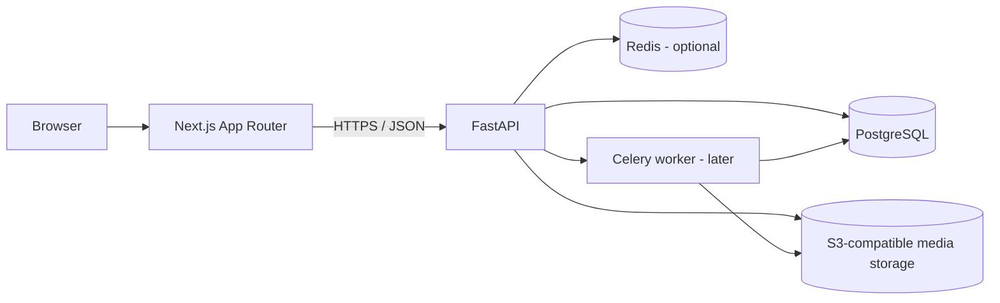

# Architecture

## 1. Goals
Build a maintainable Instagram-style social application with a Next.js web client and a FastAPI API. Keep the initial system a modular monolith: one API deployment and one PostgreSQL database, with clean domain boundaries. Split services only when scale and operational evidence justify it.

## 2. High-level topology



- **Next.js** owns routing, page rendering, client interactions, accessibility, and presentation.
- **FastAPI** owns business rules, authorization, validation, API contracts, and persistence.
- **PostgreSQL** is the source of truth for users, relationships, posts, reactions, comments, notifications, and metadata.
- **Object storage** holds image/video binaries. Database rows store object keys and metadata.
- **Redis/Celery** are optional until async tasks are needed for thumbnails, notifications, cleanup, or email.

## 3. Monorepo

```text
apps/
  web/                 Next.js App Router application
  api/                 FastAPI application
packages/
  config/              Shared project conventions
  types/               API schema/type generation destination
```

Use pnpm workspaces and Turborepo for JS/TS task orchestration. Python dependencies remain isolated in `apps/api/pyproject.toml`; Turborepo can invoke Python commands through package scripts or root tasks.

## 4. Frontend structure

```text
apps/web/src/
  app/
    (auth)/login/
    (auth)/register/
    (main)/feed/
    (main)/explore/
    (main)/notifications/
    (main)/profile/[username]/
    post/[postId]/
    layout.tsx
  components/
    layout/
    post/
    profile/
    forms/
    ui/
  features/
    auth/
    feed/
    posts/
    comments/
    follows/
    search/
    notifications/
  lib/
    api-client.ts
    auth.ts
    env.ts
  hooks/
  styles/
```

Use Server Components for read-heavy page shells where appropriate and Client Components for interactive controls (like, comment, follow, upload). Keep API calls in feature-level service modules rather than embedding fetch logic in presentational components.

## 5. Backend structure

```text
apps/api/app/
  main.py
  core/                 settings, security, logging, errors
  db/                   session, base, migrations
  api/v1/               routers and dependencies
  models/               SQLAlchemy models
  schemas/              Pydantic request/response models
  services/             business logic
  repositories/         persistence queries where useful
  workers/              async/background jobs (later)
  tests/
```

Routers should remain thin: parse/validate requests, require dependencies, call services, and return response schemas. Services enforce domain rules. Use SQLAlchemy 2 and Alembic migrations. Avoid duplicating validation between route handlers.

## 6. Core data model
- **User**: id (UUID), username (unique, normalized), email (unique), password_hash, display_name, bio, avatar_key, is_private, created_at, updated_at.
- **Follow**: follower_id, following_id, status (`pending` for private accounts, `accepted` otherwise), created_at; unique pair and no self-follow.
- **Post**: id, author_id, caption, visibility, created_at, updated_at; one post may have multiple media items.
- **PostMedia**: id, post_id, object_key, media_type, width, height, alt_text, position.
- **Like**: user_id, post_id, created_at; unique pair.
- **Comment**: id, post_id, author_id, parent_comment_id (optional), body, created_at, updated_at, deleted_at (optional).
- **SavedPost**: user_id, post_id, created_at; unique pair.
- **Hashtag**: id, name (normalized and unique); **PostHashtag** joins tags to posts.
- **Notification**: id, recipient_id, actor_id, type, entity_id, read_at, created_at.
- **Session/RefreshToken**: use secure, revocable session/refresh-token records if refresh tokens are used.

Use UUIDs for public IDs, UTC timestamps, indexes for feed/follower/post lookups, and database constraints for uniqueness and referential integrity. Define deletion behavior explicitly. Prefer soft-delete only where recovery/audit needs justify it.

## 7. API conventions
- Prefix: `/api/v1`
- JSON responses use consistent schemas; errors follow a stable shape such as `{ "detail": "..." }`.
- Cursor pagination for feed, comments, and notifications. Avoid offset pagination for large, frequently changing feeds.
- OpenAPI schema from FastAPI is the contract source. Generate TypeScript types/client from OpenAPI when practical.
- Use ISO-8601 UTC timestamps.
- Return appropriate status codes: 201 create, 204 delete where no body, 401 unauthenticated, 403 forbidden, 404 missing/inaccessible resource, 409 conflict, 422 invalid input, 429 rate limit.

### Suggested endpoints
- `POST /api/v1/auth/register`
- `POST /api/v1/auth/login`
- `POST /api/v1/auth/logout`
- `GET /api/v1/users/me`
- `PATCH /api/v1/users/me`
- `GET /api/v1/users/{username}`
- `GET /api/v1/users/{username}/posts`
- `POST /api/v1/users/{username}/follow`
- `DELETE /api/v1/users/{username}/follow`
- `GET /api/v1/feed`
- `POST /api/v1/posts`
- `GET /api/v1/posts/{post_id}`
- `DELETE /api/v1/posts/{post_id}`
- `PUT /api/v1/posts/{post_id}/like`
- `DELETE /api/v1/posts/{post_id}/like`
- `GET /api/v1/posts/{post_id}/comments`
- `POST /api/v1/posts/{post_id}/comments`
- `DELETE /api/v1/comments/{comment_id}`
- `PUT /api/v1/posts/{post_id}/save`
- `DELETE /api/v1/posts/{post_id}/save`
- `GET /api/v1/search?q=...`
- `GET /api/v1/notifications`
- `POST /api/v1/notifications/{notification_id}/read`

## 8. Authentication and authorization
For a browser-first application, prefer an HttpOnly, Secure, SameSite cookie session or short-lived access token plus rotating, revocable refresh token. Do not store long-lived tokens in localStorage. Add CSRF protection when cookie-based state-changing requests are used. Hash passwords with Argon2id. Add email verification and password reset before public launch. Rate-limit login, registration, and recovery endpoints.

Authorization must be checked server-side for every resource:
- Private profiles require an accepted follow relationship to view non-public posts.
- Only post owners can edit/delete their posts.
- Only comment owners (and authorized moderators) can delete comments.
- A user can only manage their own saved posts and account settings.
- Follow requests to private profiles are pending until accepted.

## 9. Media upload flow
1. Client requests an upload intent from the API.
2. API authenticates user, validates declared file type/size, and returns a short-lived signed upload URL or accepts a small local-dev upload.
3. Browser uploads directly to object storage.
4. Client confirms upload; API validates metadata and creates the post/media records.
5. Background worker (later) generates thumbnails and strips unsafe metadata as appropriate.
6. Serve media through a CDN or controlled object-storage URLs.

Do not trust the filename or MIME type supplied by the browser. Validate actual file content, cap file sizes, and prevent executable uploads. Use signed URLs and bucket policies that prevent public write access.

## 10. Feed behavior
MVP feed: posts from accounts the viewer follows, ordered newest-first. Include the viewer's own posts if product rules specify. Exclude deleted posts and content the viewer cannot access. Use cursor pagination and indexes on `(author_id, created_at, id)` and relationship lookup columns. Add ranking only after product metrics and abuse controls exist.

## 11. Security, privacy, and moderation
- Validate input at API boundaries and escape/render user content safely.
- Apply per-route and per-user rate limits to sensitive and abuse-prone actions.
- Add report/block flows before broad public launch; document moderation operations.
- Avoid leaking whether private users or emails exist through error messages.
- Restrict CORS to known frontend origins.
- Keep secrets in environment variables or a managed secret store.
- Log security-relevant events without logging passwords, tokens, or private message content.
- Add account export/deletion and privacy policy workflows before production release.

## 12. Observability and operations
Structured logs with request IDs; health/readiness endpoints; error monitoring; database backups and tested restores; migration checks in CI. Track latency, error rate, upload failures, sign-up conversion, and feed performance. Set explicit resource limits and retention rules.

## 13. Deployment
Deploy Next.js and FastAPI independently. Use managed PostgreSQL and object storage in production. Run Alembic migrations as a controlled release step, not automatically from every API worker. Configure HTTPS, trusted hosts, CORS, secure cookies, backups, and monitoring. Containerize the API and local dependencies for consistent development.

## 14. Implementation decisions (current slice)
Scope implemented: registration, login/logout, photo post upload, home feed, post delete.

- **Database:** Supabase Postgres. Runtime uses the transaction pooler (psycopg with `prepare_threshold=None`); Alembic uses the session pooler via `MIGRATION_DATABASE_URL`. Every table has RLS enabled with no policies so Supabase's Data API exposes nothing; the API connects as the owner and bypasses RLS.
- **Sessions:** opaque random token in an HttpOnly, SameSite=Lax cookie (`socially_session`); only its SHA-256 is stored (`user_sessions`). Logout deletes the row (server-side revocation); login always issues a fresh token (no fixation).
- **CSRF:** `socially_csrf` cookie = HMAC(SECRET_KEY, session token), echoed by the client in `X-CSRF-Token` on unsafe methods. Unsafe requests with a foreign `Origin` are rejected.
- **Same-origin API:** the browser calls `/api/v1/*` on the web origin; Next.js rewrites forward to FastAPI. Cookies stay first-party and no credentialed CORS is required. Server components call the API directly with the session cookie (`src/lib/server-api.ts`).
- **Route protection:** `src/proxy.ts` redirects on cookie presence (routing hint only); the `(main)` layout verifies the session with the API; the API enforces auth on every endpoint.
- **Uploads:** a single multipart `POST /api/v1/posts` (≤10 images, ≤10 MB each). Pillow decodes the bytes (filename/MIME ignored), applies EXIF orientation, and re-encodes to WebP at 1440px and 640px, which strips metadata. Files live on local disk under `MEDIA_ROOT`; served by `GET /api/v1/media/{id}` behind auth. Upload intents + S3-compatible storage come next, behind the same `services/media.py` boundary.
- **Feed:** all non-deleted posts from active users, newest first, cursor = base64(`created_at|id`) with `(created_at, id)` index. Becomes follow-filtered when the follow graph lands.
- **Deletion:** posts are soft-deleted (`deleted_at`); their image files are removed immediately.
- **Rate limits:** in-process sliding window (register 5/h/IP, login 20/5min/IP + 10/5min/identifier, uploads 30/h/user). Single API worker until moved to Redis.
- **Likes/comments:** `likes` has a composite PK (user, post) and likes use `INSERT … ON CONFLICT DO NOTHING`, so duplicate or concurrent likes count once. Feed/post responses carry `like_count`, `comment_count`, `viewer_has_liked`, loaded with three grouped queries per page. Comments are oldest-first with a `(post_id, created_at, id)` cursor, soft-deleted, and removable by their author or the post owner. The UI likes optimistically and rolls back on failure.
